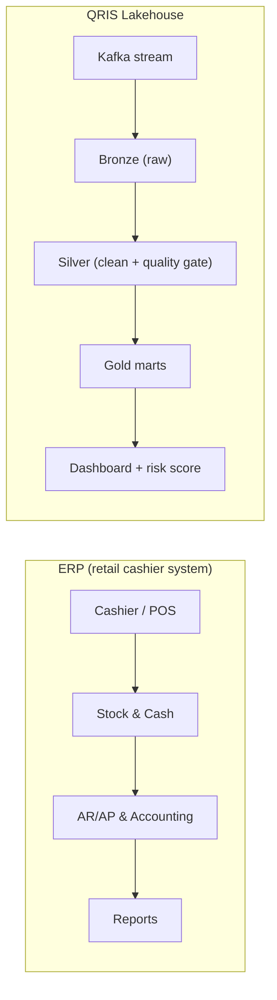

# QRIS Streaming Lakehouse - Real time Fraud Analytics

[](https://github.com/wardalxndr/qris-streaming-lakehouse/actions/workflows/ci.yml)

QRIS is Indonesia's national instant payment rail.
Simulated QRIS payment stream → bronze/silver/gold lakehouse → fraud marts + dashboard.
Built to be reproducible: one seed regenerates everything.

## Quickstart
```powershell
py -3.11 -m venv .venv
.\.venv\Scripts\Activate.ps1
pip install scikit-learn pytest        # light path: local pipeline + tests only
python pipeline/run_pipeline.py        # seed=42 -> data/*.csv + reports/*.json
python -m pytest -q                    # 7 tests, 1 skipped (Kafka)
```
Full `requirements.txt` adds the optional heavy paths: Airflow (DAG), PySpark
(streaming job) and google-cloud-bigquery (BigQuery load).

## System Analyst Documentation
- **Architecture & Data Flow:** [DFD Architecture](docs/architecture.md) | [Swimlane Flows](docs/flows.md) | [Use Cases](docs/use-cases.md)
- **Business Rules & Data Specs:** [Data Validation Rules](docs/data-validation-rules.md) | [Payload Contract](docs/payload.md) | [Fraud Specifications](docs/fraud-specifications.md)
- **Database & Edge Cases:** [ERD Schema](docs/erd.md) | [Edge Cases & Error Handling](docs/edge-cases.md)
- **NFR & Acceptance:** [NFR](docs/nfr.md) | [Acceptance Criteria](docs/acceptance-criteria.md)

## Design decisions (ADRs)
Every non-obvious engineering choice is documented in [docs/adr](docs/adr/README.md) with its context, the honest downsides and the alternatives that were rejected. Highlights:
- [0001](docs/adr/0001-two-ingestion-paths.md): why the repo ships a Kafka stream path AND a seeded batch path.
- [0003](docs/adr/0003-seeded-artifacts-and-ci-repro-gate.md): why artifacts are committed and CI diffs them on a clean checkout.
- [0006](docs/adr/0006-champion-challenger-retrain-gate.md): why the retrain gate exists, and why the first challenger was NOT promoted.
- [0007](docs/adr/0007-partition-and-cluster.md): why each mart is partitioned/clustered the way it is.

## Problem
QRIS money moves fast, so fraud must be caught fast. This pipeline answers:
which merchants leak fraud volume, what fraud types trend daily, which users are high risk.

## Architecture (simulated stream + batch)
```
pipeline/gen_qris.py (seed=42, 100k txns, 2% fraud, 4 types)
  -> data/bronze/qris_raw.csv       # raw stream landing
  -> pipeline/clean_silver.py       # dedup, validate, velocity window flags
  -> data/qris_clean.csv
  -> pipeline/build_gold.py         # mart_merchant_volume, mart_fraud_flags, mart_user_risk
  -> pipeline/load_to_bq.py         # BigQuery dataset qris_analytics
  -> Looker Studio dashboard (3 tiles): https://datastudio.google.com/reporting/a1e01ca3-4d6d-466e-b8d4-f32954e4b872/page/PvWAG
```
## Real time (local Kafka, Docker)
```
docker compose -f docker-compose.kafka.yml up -d   # KRaft broker (auto-creates qris-txns, 3 partitions)
python pipeline/produce.py    # send 100K events
python pipeline/consume.py    # clean live -> data/qris_clean_live.csv
```
Proven: consumer down during produce → caught up 100,000/100,000, 0 duplicates, 0 lost.
Spark Structured Streaming reference: `python pipeline/make_bronze_stream.py` then
`spark-submit spark/spark_streaming_job.py` (needs PySpark + Java; on Windows also
winutils.exe/HADOOP_HOME). Roadmap: cloud deploy.

## ERP mapping



Same domain pattern, different domain: layered transactions from cashier to report.
This process mapping skill transfers to the System Analyst role.

## Results
- 100,000 txns, 1.95% fraud (velocity / night / round_amount / new_device)
- 0 duplicates, 0 corrupt rows after quality gates
- 39 high risk users (score >= 8)

```
python pipeline/run_pipeline.py   # generate -> silver -> gold -> forecast -> model (one command)
```

## Dashboard (Looker Studio)
Live report: [QRIS Fraud Analytics](https://datastudio.google.com/reporting/a1e01ca3-4d6d-466e-b8d4-f32954e4b872/page/PvWAG)

Three tiles, each backed by a BigQuery mart:
1. Merchant volume (leak watch) - `mart_merchant_volume`
2. Daily fraud by type - `mart_fraud_flags`
3. High risk users (score >= 8) - `mart_user_risk`

Tile design, verified numbers and the refresh steps: [docs/dashboard.md](docs/dashboard.md).

## BigQuery load (optional, needs GCP)
`pipeline/load_to_bq.py` loads silver into the `qris_analytics` dataset
(table `silver_transactions`); gold marts are built by dbt, not this script.
```powershell
$env:GCP_PROJECT_ID="<your-gcp-project>"
$env:GOOGLE_APPLICATION_CREDENTIALS="C:\path\to\service-account.json"
python pipeline/load_to_bq.py
```
Keep the service-account JSON outside the repo and never commit it
(`.gitignore` already excludes `secrets/` and `*.sa.json`).

## Cost (measured, not estimated)
All numbers below come from the actual runs of this repo (BigQuery US on-demand pricing).

| Item | Measured usage | Cost |
|---|---|---|
| Batch load, 100k rows, local file | 1 load job | $0.00 (batch loads are free) |
| `dbt run` (1 view + 3 marts) | 8.4 MiB scanned | ~$0.00005 |
| Storage (silver + 3 marts) | ~15 MB active | ~$0.0003 / month |
| Looker Studio report | 1 report, 3 tiles | $0.00 |
| Kafka + Airflow | self-hosted Docker | $0.00 |
| **Total cloud spend** | | **under $0.01 / month** |

What it would cost to make the stream fully cloud-native (us-central1 list
prices, ballpark): Pub/Sub at this volume stays inside the free 10 GB/month,
while a minimal always-on Dataflow streaming job (2 vCPU, 8 GB) is roughly
$165/month just to exist. That is the honest reason the streaming demo is
local: the mechanics are transferable, the bill is not.

## Tests
```powershell
python -m pytest -q                        # data quality invariants + ML/retrain loop (full pipeline in a temp dir)
$env:QRIS_KAFKA="1"; python -m pytest -q   # optional: adds the Kafka E2E test (broker must be running)
```
CI (`.github/workflows/ci.yml`) re-runs the seeded pipeline, asserts the committed
data artifacts reproduce on a clean checkout (seed=42), then runs the same suite.

Lakehouse layout (same pattern as a retail Walmart project, upgraded to QRIS):
`pipeline/` runs locally, `spark/` is a Spark Structured Streaming reference,
`dags/` a daily Airflow example, `sql/` analytics queries, `data/` outputs, `reports/` metrics.

## Machine learning
`pipeline/model.py` trains a LogisticRegression (fraud probability per transaction,
time split: 3 weeks train, 1 week test). Honest metrics in `reports/model_metrics.json`
(precision/recall/F1 + chosen threshold). Rules stay alongside the model:
rules catch clear patterns (velocity needs history, a single-row model cannot see that),
the model gives a probability whose threshold shifts with risk appetite.

## Retraining loop (living model, not one-shot)
Fraud shifts, so the model must be re-measured and re-challenged on a schedule:
1. `pipeline/score.py` scores silver with the champion model, stamping model_version per row.
2. `pipeline/reconcile.py` replays delayed labels (default 2 days, like production where labels arrive late) and reports precision/recall/F1 + drift flags to `reports/reconcile_metrics.json`. Always exits 0: monitoring, not a gate.
3. `pipeline/retrain.py` trains a challenger on the newest 21-day window, tests on the newest week, and promotes only if F1 beats champion by >= 0.005. Old models are never deleted; `reports/model_registry.json` is the source of truth. First run here: challenger tied champion, correctly NOT promoted.
```
python pipeline/run_retrain.py   # score -> reconcile -> retrain
```
The Airflow DAG chains the same three tasks after forecast. Honest scope: labels are simulated with delay; the mechanics (versioning, gate, registry) are production patterns.

## Forecast
`pipeline/forecast.py` forecasts daily fraud 7 days ahead (7-day average x weekday
factor x payday boost, like Walmart holiday features). 7-day backtest: MAE ~81 vs
~136/day average - naive v1 model, honestly recorded in `reports/forecast_metrics.json`.

## Troubleshooting
Real issues hit while building this on Windows, and their fixes:
- `Python was not found` for `python`/`pip`: that is the WindowsApps stub. Use `py -3.11 -m venv .venv`, or `uv run --python 3.11 --with <pkg> python <script>` for one-off runs.
- Spark job fails with `HADOOP_HOME and hadoop.home.dir are unset`: Spark on Windows needs winutils.exe. Run the Spark reference job on Linux/WSL/CI; the batch and Kafka paths do not need it.
- Kafka test skipped: it only runs when the broker is up AND `QRIS_KAFKA=1` is set. Start `docker compose -f docker-compose.kafka.yml up -d` first.
- `dbt debug` cannot find a profile: pass `--profiles-dir`, or copy `qris_analytics/profiles.example.yml` to `~/.dbt/profiles.yml` and fill it in.
- BigQuery `403 PERMISSION_DENIED`: enable billing on the project and give the service account BigQuery Data Editor + BigQuery Job User.

## Source
Synthetic data (own generator). Fraud patterns modeled on common e-wallet typologies.

## License
MIT - see [LICENSE](LICENSE).
