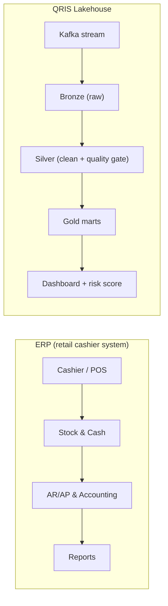

# QRIS Streaming Lakehouse - Real time Fraud Analytics

[](https://github.com/wardalxndr/qris-streaming-lakehouse/actions/workflows/ci.yml)

QRIS is Indonesia's national instant payment rail.
Simulated QRIS payment stream → bronze/silver/gold lakehouse → fraud marts + dashboard.
Built to be reproducible: one seed regenerates everything.

## System Analyst Documentation
- **Architecture & Data Flow:** [DFD Architecture](docs/architecture.md) | [Swimlane Flows](docs/flows.md) | [Use Cases](docs/use-cases.md)
- **Business Rules & Data Specs:** [Data Validation Rules](docs/data-validation-rules.md) | [Payload Contract](docs/payload.md) | [Fraud Specifications](docs/fraud-specifications.md)
- **Database & Edge Cases:** [ERD Schema](docs/erd.md) | [Edge Cases & Error Handling](docs/edge-cases.md)
- **NFR & Acceptance:** [NFR](docs/nfr.md) | [Acceptance Criteria](docs/acceptance-criteria.md)

## Problem
QRIS money moves fast, so fraud must be caught fast. This pipeline answers:
which merchants leak fraud volume, what fraud types trend daily, which users are high risk.

## Architecture (simulated stream + batch)
```
pipeline/gen_qris.py (seed=42, 100k txns, 2% fraud, 4 types)
  -> data/bronze/qris_raw.csv       # raw stream landing
  -> pipeline/clean_silver.py       # dedup, validate, velocity window flags
  -> data/qris_clean.csv
  -> pipeline/build_gold.py         # mart_merchant_volume, mart_fraud_flags, mart_user_risk
  -> pipeline/load_to_bq.py         # BigQuery dataset qris_analytics
  -> Looker dashboard (3 tiles)
```
## Real time (local Kafka, Docker)
```
docker compose -f docker-compose.kafka.yml up -d   # KRaft broker (auto-creates qris-txns, 3 partitions)
python pipeline/produce.py    # send 100K events
python pipeline/consume.py    # clean live -> data/qris_clean_live.csv
```
Proven: consumer down during produce → caught up 100,000/100,000, 0 duplicates, 0 lost.
Spark Structured Streaming reference: `python pipeline/make_bronze_stream.py` then
`spark-submit spark/spark_streaming_job.py` (needs PySpark + Java; on Windows also
winutils.exe/HADOOP_HOME). Roadmap: cloud deploy.

## ERP mapping



Same domain pattern, different domain: layered transactions from cashier to report.
This process mapping skill transfers to the System Analyst role.

## Results
- 100,000 txns, 1.95% fraud (velocity / night / round_amount / new_device)
- 0 duplicates, 0 corrupt rows after quality gates
- 39 high risk users (score >= 8)

```
python pipeline/run_pipeline.py   # generate -> silver -> gold -> forecast -> model (one command)
python pipeline/load_to_bq.py   # BigQuery dataset qris_analytics (needs service-account JSON)
```

## Tests
```powershell
python -m pytest -q                        # data quality invariants + ML/retrain loop (full pipeline in a temp dir)
$env:QRIS_KAFKA="1"; python -m pytest -q   # optional: adds the Kafka E2E test (broker must be running)
```
CI (`.github/workflows/ci.yml`) re-runs the seeded pipeline, asserts the committed
data artifacts reproduce byte-for-byte (seed=42), then runs the same suite.

Lakehouse layout (same pattern as a retail Walmart project, upgraded to QRIS):
`pipeline/` runs locally, `spark/` is a Spark Structured Streaming reference,
`dags/` a daily Airflow example, `sql/` analytics queries, `data/` outputs, `reports/` metrics.

## Machine learning
`pipeline/model.py` trains a LogisticRegression (fraud probability per transaction,
time split: 3 weeks train, 1 week test). Honest metrics in `reports/model_metrics.json`
(precision/recall/F1 + chosen threshold). Rules stay alongside the model:
rules catch clear patterns (velocity needs history, a single-row model cannot see that),
the model gives a probability whose threshold shifts with risk appetite.

## Retraining loop (living model, not one-shot)
Fraud shifts, so the model must be re-measured and re-challenged on a schedule:
1. `pipeline/score.py` scores silver with the champion model, stamping model_version per row.
2. `pipeline/reconcile.py` replays delayed labels (default 2 days, like production where labels arrive late) and reports precision/recall/F1 + drift flags to `reports/reconcile_metrics.json`. Always exits 0: monitoring, not a gate.
3. `pipeline/retrain.py` trains a challenger on the newest 21-day window, tests on the newest week, and promotes only if F1 beats champion by >= 0.005. Old models are never deleted; `reports/model_registry.json` is the source of truth. First run here: challenger tied champion, correctly NOT promoted.
```
python pipeline/run_retrain.py   # score -> reconcile -> retrain
```
The Airflow DAG chains the same three tasks after forecast. Honest scope: labels are simulated with delay; the mechanics (versioning, gate, registry) are production patterns.

## Forecast
`pipeline/forecast.py` forecasts daily fraud 7 days ahead (7-day average x weekday
factor x payday boost, like Walmart holiday features). 7-day backtest: MAE ~81 vs
~136/day average - naive v1 model, honestly recorded in `reports/forecast_metrics.json`.

## Source
Synthetic data (own generator). Fraud patterns modeled on common e-wallet typologies.
