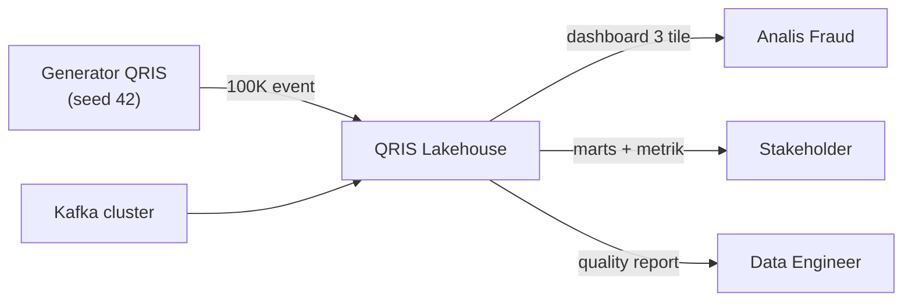
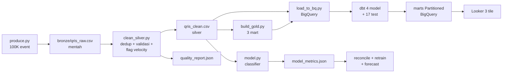

# Arsitektur & DFD - QRIS Lakehouse

## Diagram konteks (level 0)

Satu sistem, tiga konsumen. Analis dapat jawaban, stakeholder dapat
keputusan, engineer dapat alarm kalau ada yang busuk.

## DFD level 1 (aliran data)

Aturan baca: kotak = proses/file, panah = data mengalir. Tidak ada
panah dua arah: data tidak pernah jalan mundur.

Dashboard live (Looker Studio, 3 tile): [QRIS Fraud Analytics](https://datastudio.google.com/reporting/a1e01ca3-4d6d-466e-b8d4-f32954e4b872/page/PvWAG).
