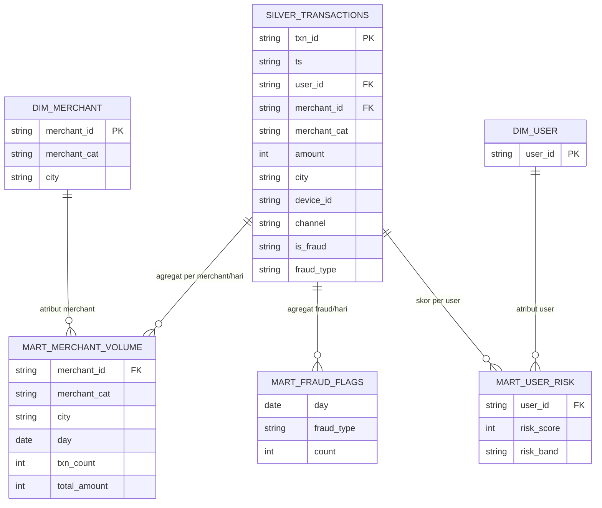

# Skema Data & ERD - QRIS Lakehouse

## Silver (fakta mentah bersih): `silver_transactions`

Satu baris = satu transaksi unik (dedup by `txn_id`).

## Catatan desain (dibaca reviewer)

- `ts` disimpan STRING di silver karena format sumber `%Y-%m-%d %H:%M`
  bukan TIMESTAMP valid. Parsing ke TIMESTAMP + DATE (`event_ts`,
  `event_date`) terjadi di dbt staging (`stg_qris`), bukan saat load.
  Keputusan sadar: load tidak pernah gagal gara-gara format tanggal.
- Kolom `day` di mart bertipe DATE (hasil cast), namanya dipertahankan
  supaya dashboard lama tidak perlu ganti field.
- `mart_user_risk` tanpa partition: snapshot per user, bukan series waktu.
  Cluster `user_id` karena semua lookup filter user.
